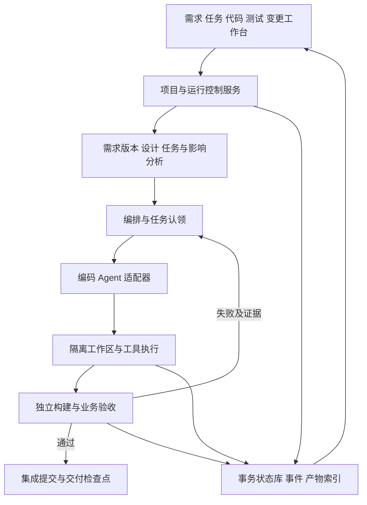

# 软件研发 Agent 平台目标需求

版本：v0.2 讨论基线。日期：2026 年 11 月 10 日。

本项目的目标提升为：用户提供复杂业务的全栈 Web 项目需求后，平台组织 Agent 完成分析、设计、编码、运行、测试、修复、需求变更和交付，并通过工作台展示可核验的进展。编码与测试实现主要由 Agent 承担，人负责产品目标、必要决策、评审和验收。

本文件描述目标产品；当前代码的已实现行为见 [现有原型设计](DESIGN.md) 和 [验证记录](VERIFICATION.md)。功能列入目标不代表已经实现。

## 一 已确认的方向

- 开发方式：Agent 承担主要软件实现，人负责目标、边界、审阅和最终验收。
- 推进方式：不设固定周次排期，以验收结果和质量改进推进，允许 Agent 持续迭代开发。
- 优先场景：深入支持复杂业务的全栈 Web 项目，覆盖权限、持久化数据、跨模块流程、测试及持续需求变更。
- 产品交付：可运行的软件、版本化源码、测试证据、变更历史、交付文档及可视化工作台。
- 已接入的模型：DeepSeek 已完成一次真实规格整理调用；编码工具循环的兼容性需要独立验证。

需要区分两个层次：开发本平台时，人类管理编码 Agent；平台交付后，平台自身通过程序接口调度 Agent 来开发用户的目标项目。聊天中的 Agent 能力需要经正式执行接口接入，才能成为产品能力。

## 二 支持范围和质量目标

主支持路径采用一套经过验证的 Web 技术栈，覆盖前端、API、关系型数据存储和自动化测试。首先在业务深度、持续变更和可靠性上达到较高完成度，再增加其他技术栈。确切框架、数据库和执行器通过真实工具兼容性实验确定。

最终参考项目应包含多个关联业务模块，至少涉及以下行为：

- 登录、角色权限以及项目内数据访问边界。
- 数据新增、编辑、查询、分页和组合筛选。
- 明确的业务状态流转、非法跳转校验及审计记录。
- 并发请求下的数据一致性，例如库存与借阅记录同时更新。
- 输入校验、异常提示和操作反馈，桌面与手机的完整业务操作。
- 新增字段、修改权限、调整流程等需求变化后的数据及代码兼容。

完成依据包括构建、实际业务测试、回归结果和干净环境复现。Agent 的自述、代码量、文件数量或流程节点全部变绿，不能单独作为交付完成依据。

## 三 核心能力和验收

优先级表示实现依赖和顺序。P0 是执行基础，P1 是高完成度交付的一部分；本次目标包含下列全部能力。

| 编号 | 能力 | 优先级 | 可验收结果 |
| --- | --- | --- | --- |
| F01 | 需求理解和澄清 | P0 | 区分目标、角色、必需功能、约束、验收及未决范围；保留原文关联，阻塞性歧义有明确处理结果。 |
| F02 | 工程设计和任务规划 | P0 | 生成真实模块契约、数据模型、开发任务及依赖；每项任务有输入版本、修改范围、验收条件和证据要求。 |
| F03 | 真实编码执行 | P0 | Agent 在独立工作区创建前后端、数据结构与迁移、配置及启动说明；能够安装依赖并启动项目。 |
| F04 | 独立验证与限次修复 | P0 | 执行构建、接口和浏览器业务测试；基于失败结果修复，超过预算明确停止，保留现场。 |
| F05 | 版本化需求变更 | P0 | 同一项目提交修改后产生新需求及计划版本，显示范围变化、影响分析、复用和重跑决定，保留旧结果。 |
| F06 | 多 Agent 协作与集成 | P1 | 独立任务可以真实并行；每个修改有分支或工作区归属，共享文件有唯一写入责任，合并后重新验证。 |
| F07 | 可视化研发工作台 | P0 | 同时查看任务图、Agent 活动、代码差异、实际命令结果、测试报告、运行预览、变更和阻塞原因。 |
| F08 | 检查点与故障恢复 | P0 | Agent 崩溃、服务重启和工具超时后能识别未完成尝试，从有效检查点继续；陈旧结果不混入新版本。 |
| F09 | 资源与成本控制 | P0 | 每次运行有时间、工具调用和修复轮次预算；能停止进程、保留证据；用量及费用估算分别标注。 |
| F10 | 团队审阅与权限 | P1 | 负责人、评审者和观察者可以协作；对需求变更、外部发布等关键动作有权限检查和操作记录。 |
| F11 | 可复现交付与回滚 | P1 | 下载与已验证提交对应的源码、依赖锁定、迁移、配置样例和验证报告；可恢复上一可用代码版本。 |

### 功能完成的约束

任务先产出候选代码，再进入验证。只有与当前需求、计划、代码提交及测试版本匹配的验证结果，才允许将该任务计入完成。合并发生后必须在集成提交上运行必要验证。

实现 Agent 可以编写单元测试和提出验收用例变更，但不能自行放宽、删除或跳过已经固定的独立验收。验收 Agent 的测试配置和发布判定由验证服务管理，模型不能直接将状态改为通过。

必需验收清单版本固定测试入口、数据和失败规则，由独立验证进程执行。实现 Agent 不拥有该清单及验证结果的写权限；可以提交测试改进提案，经审阅后形成新的清单版本。测试通过结果绑定实际候选或集成提交，不能跨提交直接沿用。

### 自动执行和人工决策

常规文件编辑、受限环境中的构建及测试可以连续自动执行。阻塞性需求冲突、破坏性数据迁移、超预算和外部发布进入明确的待决策状态。界面应让用户知道等待的是谁、需要决定什么，以及决定如何影响后续任务。

## 四 需求变更协议

用户可以随时提交变更请求，系统在安全检查点应用变更。首个完整版本不承诺强行中断任意运行中的工具并立即应用新需求。

1. 保存变更请求，生成不可变的需求新版本，展示新增、删除和修改的内容。
2. 根据需求到任务、任务到代码及验证结果的关联，生成影响范围和理由；用户可以审阅和调整范围。
3. 暂停启动受影响任务。已运行任务可以收尾，但其结果只归属旧版本；新版本不能接收旧版本结果冒充的完成状态。
4. 为受影响任务生成新计划，标记旧结果失效；仅在依赖版本和输入一致时复用不受影响结果。
5. 执行代码变更、必要的数据迁移和相关测试，再执行关键全局回归。
6. 形成新版本交付与差异说明，保留旧需求、旧提交和旧报告。

无法可靠判断影响范围时，应扩大重跑和回归范围，并在界面说明。精确复用属于优化，正确性优先于节省模型调用。

必须验证三类变更：新增数据字段及界面、修改角色权限、调整业务状态流程。涉及数据库的变更不能只修改页面和类型定义，还需要处理已有数据及迁移。

## 五 目标架构

控制服务负责项目、权限、版本、预算、任务调度和状态。执行层负责 Agent 会话、工具、工作区、进程和预览。独立验证层执行测试并发布结果。模型返回内容始终作为候选决定，由程序检查版本、权限和状态后应用。

### 数据与结果归属

需要明确记录 SpecRevision、PlanRevision、Task、Attempt、Workspace、Candidate、ValidationManifest、Artifact、TestReport、Approval、ChangeRequest、Checkpoint 和 UsageRecord。产物至少关联 project_id、需求版本、计划版本、task_id、attempt_id 和代码提交；关键输入还记录内容标识。

任务认领与状态变化需要事务和唯一性约束。每次认领包含租约和代次编号，失去租约或版本过期的 Worker 不能继续发布有效结果。事件采用可排序的唯一编号，重新连接后可以补齐，不重复显示为新操作。

控制服务重启后先与外部 Worker 协调实际状态，不能仅凭 API 服务重启就判断编码进程已经停止。状态未确定时显示协调中；取消请求在收到停止确认前不显示已取消。并发任务需要先预留预算，再按实际用量结算；无法获取的用量标为未知。

### 多 Agent 写入与集成

独立任务使用独立分支和工作目录。共享接口、依赖清单及数据库迁移有明确的修改责任和集成顺序。Worker 提交候选改动，集成服务基于指定的基础提交合并，解决冲突后重新验证。多个会话指向同一目录不构成有效的写入隔离。

公共集成分支和共享 Git 元数据由集成服务管理，Worker 不拥有任意改写其他任务或公共主线的权限。工作区独立解决直接文件覆盖，业务冲突仍由集成检查和回归测试处理。

Git worktree 可以支持同一仓库的多个工作树，但代码分支管理和进程资源隔离仍需分别设计。[Git 官方文档](https://git-scm.com/docs/git-worktree)

### 执行环境

目标项目在独立受限环境运行，限制文件挂载、进程、CPU、内存、执行时长和可用网络。模型服务凭证由受控服务保管，不能随目标仓库和日志导出。运行预览通过受控入口映射到对应项目和版本。

容器机制需要结合配置和资源限制使用，不能将“使用 Docker”直接解释为已完成安全隔离。[Docker 安全说明](https://docs.docker.com/engine/security/)

### 当前原型的升级方式

| 已有部分 | 延续方式 | 必须新增的内容 |
| --- | --- | --- |
| 需求导入与规格预览 | 继续作为用户入口 | 同项目需求版本、澄清和变更请求 |
| 固定文档工作流 | 保留为规划子流程 | 动态开发任务、执行器、验证和集成 |
| 阶段状态与日志 | 迁移为统一事件协议 | 工具事件、代码提交、证据及版本归属 |
| JSON 项目存档 | 作为迁移来源和导出格式 | 事务状态库、并发任务认领、恢复协议 |
| task.md 与依赖图 | 继续作为可读计划和可视化 | 结构化执行契约、输入版本及失效机制 |
| 人工审阅与 ZIP | 延续交互 | 差异审阅、业务预览、验证对应交付包 |

## 六 评估与发布门禁

最终验收采用复杂业务场景，而不只演示待办页面。建议准备工单审批、图书借阅、设备预约三类公开需求；每类有独立业务验收和至少一次需求变更。另保留一份未直接用于调试的同类需求，用于观察泛化效果。正式开展独立评估前固定样例、判定规则和运行预算，后续更新保留版本。

| 编号 | 评估内容 | 通过依据 |
| --- | --- | --- |
| E01 | 全栈项目生成 | 实际启动前后端和存储，浏览器可以完成核心业务，交付代码可下载。 |
| E02 | 权限与流程 | 合法操作成功，越权及非法状态变更被后端拒绝，原始数据保持正确。 |
| E03 | 数据一致性 | 并发竞争同一资源时符合业务约束，重启后数据与历史记录仍正确。 |
| E04 | 测试与修复 | 从真实失败报告修复；达到上限时明确失败，不删除验收或伪造通过。 |
| E05 | 持续变更 | 字段、权限、流程三类修改能形成新版本，并通过新增验收及关键回归。 |
| E06 | 并行集成 | 至少两个独立任务实际并行；合并结果通过验证，共享文件写入有明确归属。 |
| E07 | 故障恢复 | 注入工具超时、Worker 退出、控制服务重启；旧尝试不重复提交或污染新版本。 |
| E08 | 进度可核验 | 任一完成任务可追溯到改动、命令、测试与产物；展示失败和等待原因。 |
| E09 | 可复现交付 | 在干净环境按说明启动交付版本，运行预先固定的验收。 |

评估记录所有尝试，包括失败、人工介入、模型和预算、修复次数、耗时及交付限制。由模型生成的成功总结不能替代测试进程结果。公开展示的成功率要注明样例和尝试次数。

## 七 持续开发原则

纯 Agent 开发将主要实现工作交给 Agent，围绕实际业务效果进行需求、设计、编码和验证的多轮迭代。独立任务可以并行，接口、集成、版本切换和发布验证按依赖推进。

具体建设顺序见 [实现流程](ROADMAP.md)。先验证真实编码接口并打通完整全栈链路，再完善多 Agent 协作、需求变更、恢复和交付质量。每轮保留通过验证的版本，根据实际差距进入下一轮；通过验收的当前版本可以交付，后续继续扩展能力和提高质量。
