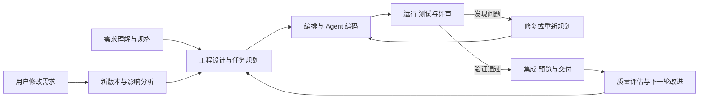

# 软件研发 Agent 平台实现流程

目标是让用户提供一份需求文档后，平台自动组织 Agent 完成复杂全栈 Web 项目的分析、设计、编码、测试、修复和交付，并支持开发过程中的需求修改。实现按能力依赖与验收结果推进，允许持续迭代，以项目完成效果为主要目标。

本文描述目标实现流程；当前已实现范围见 [现有原型设计](DESIGN.md)，完整能力要求见 [产品需求](PRODUCT_REQUIREMENTS.md)。

## 整体流程

可视化工作台贯穿整个流程，展示真实任务、代码、执行记录、测试结果和项目预览。

## 一 建立需求理解与工程规划能力

接收需求文档，整理业务目标、用户角色、功能、数据、约束和验收条件，识别需要澄清的问题。随后形成架构、数据库模型、接口和开发任务，输出规格、设计和 task.md。

需求、计划和产物具有明确版本，后续每项代码改动与验证结果都能追溯到对应需求。

## 二 接通真实开发执行能力

让 Agent 能在独立工作区读取仓库、编辑代码、安装依赖、运行程序和测试，逐步形成完整的前端、后端和数据库工程。编排器依据依赖、当前状态和运行结果安排任务；适合并行的任务由多个 Agent 协作完成。

先打通一条从需求到可运行全栈项目的完整链路，再持续提高规划质量、项目复杂度和执行稳定性。已有规划台作为入口和控制基础继续演进。

## 三 建立测试与自动修复闭环

对候选代码进行构建、接口测试、浏览器业务测试和代码评审，重点验证权限、状态流转、数据一致性及异常处理。将具体失败反馈给 Agent，修复后重新验证。

独立验收标准保持版本化，实现 Agent 不能为了通过检查而自行放宽标准。单个问题反复修复无进展时，保留现场并重新分析方案，避免重复同一失败路径。

## 四 完成集成与可视化工作台

将各模块及 Agent 的候选改动集成，在集成版本上运行回归测试。前端提供任务依赖图、执行日志、代码差异、测试报告、运行预览和必要的人工介入操作。

界面中的完成状态对应真实代码和验证证据；用户能够查看当前在做什么、为什么受阻，以及已经交付了什么。

## 五 支持持续需求变更

用户修改功能后，保存需求新版本，分析受影响的任务、代码、数据和测试，重新规划并执行必要修改。明确无关且输入一致的成果可以复用，受影响结果重新验证；判断不充分时扩大回归范围。

保留旧版本、代码差异和验证记录，防止旧任务的迟到结果覆盖新需求。逐步完善数据迁移、增量开发和跨模块变更能力。

## 六 持续提升工程质量

反复使用不同复杂业务需求和故障场景检验平台，持续改进功能完整性、交互体验、权限与数据正确性、性能、可维护性和可复现性。补齐任务隔离、检查点恢复、停止与回滚、资源和成本控制。

每轮选择有证据支持的高优先级问题形成新任务；保留通过验证的版本，再开始下一轮。长期开发由有明确结果的多轮迭代组成，每轮都能暂停、检查和调整目标。

## 七 形成可交付成果并继续迭代

将通过验收的代码版本、数据库迁移、配置样例、运行说明和测试报告组成交付包，在干净环境实际启动并完成核心业务。用户可以预览、验收和下载当前可用版本。

交付后仍可继续增加功能、改善体验和提高可靠性。持续循环为：发现差距、规划任务、Agent 实现、独立验证、集成回归、保存可用版本，再进入下一轮。
