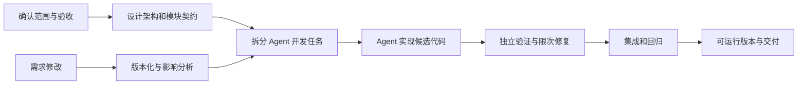

# 软件研发 Agent 平台开发流程规划

日期：2026 年 11 月 10 日。状态：面向高完成度目标的计划，尚未全部实现。

目标见 [产品需求](PRODUCT_REQUIREMENTS.md)。六人团队采用 Agent 主导实现方式，成员负责产品和工程决策、评审与验收。现有程序提供规划台基础，目标平台需要新增真实研发执行层。

本规划说明我们如何开发这个平台。最终平台的业务目标是：接收软件需求文档，自动组织 Agent 生成并验证复杂全栈 Web 项目，支持需求修改，并交付可运行的软件及相应证据。八周按相对周次安排，在第 2 周和第 4 周根据实际进展校准。

## 一 总体开发流程

| 阶段 | 主要工作 | 阶段产物 | 退出条件 |
| --- | --- | --- | --- |
| 范围与需求 | 明确平台功能、目标应用范围、角色和质量标准，固定参考业务及验收用例。 | 产品需求与验收清单 | 团队能判断哪些行为算完成，未决范围有记录。 |
| 工程设计 | 约定规划、调度、执行、验证、存储和前端之间的接口，验证模型与工具能否真实执行。 | 架构、接口和接入实验结果 | 编辑代码、运行命令和读取测试结果的正式调用链可用。 |
| 任务与实现 | 将模块拆成带依赖、修改范围和验收的任务，分派 Agent 开发并评审。 | task 文档、候选提交 | 各模块有真实产物，能够按契约集成。 |
| 验证与修复 | 运行构建、接口、浏览器业务测试，收集失败并让 Agent 有限次修复。 | 测试报告和修复记录 | 必需测试通过，或明确失败并交接原因，不能自行放宽验收。 |
| 变更与完善 | 增加需求版本、影响分析、增量执行、多 Agent 集成、恢复和完整交互。 | 连续版本及变更记录 | 修改后的功能与旧功能回归均有证据，历史结果保留。 |
| 稳定与交付 | 使用新需求及故障场景评估，修复缺陷，在干净环境复现并准备答辩。 | 发布版本、运行说明、评估和演示材料 | 其他成员可按说明启动，能复核需求、代码及测试结果。 |

前端、独立测试和接口设计从前期并行推进，每周都交付可演示版本。实现范围逐步扩展，完整复杂业务能力按最终验收清单检查。

## 二 开发本平台的协作方式

由一个主控 Agent 维护总体依赖与接口；按有明确产物的任务分派实现 Agent、测试 Agent 和评审 Agent。每个任务必须提供基础提交、允许修改的模块、禁止触碰的内容、验收条件和提交证据。

每个模块由一位成员对结果负责，可以管理多个 Agent。人工评审不要求逐行手写代码，但需要能解释关键数据流、业务规则和验收结果。发现问题后通过任务反馈让 Agent 修正。

| 人类负责人 | 主要决策和验收责任 | 对应 Agent 工作 |
| --- | --- | --- |
| 产品与业务 | 支持边界、角色、业务流程、需求变更优先级 | 需求分析、用例、规格与问题清单 |
| 架构与契约 | 模块协议、数据版本、状态和接口一致性 | 数据模型、类型和契约实现及评审 |
| Agent 执行 | 工具适配、工作区、进程和模型兼容性 | 编码执行器、隔离与工具事件 |
| 验证与评估 | 固定验收、失败判定、变更回归及结果复核 | 独立测试、评估器和修复反馈 |
| 交互与体验 | 任务、代码、预览、审阅和协作操作 | 前端实现、交互测试和视觉检查 |
| 集成与交付 | 分支集成、运行环境、发布门禁和干净环境复现 | CI、迁移、交付与故障演练 |

共享文件和接口保留唯一写入责任，其他 Agent 通过约定提交变更。六名成员不分别维护互不兼容的架构。每次合并在集成提交上运行必要检查。

每次 Agent 开发采用固定循环：负责人提供任务和上下文，Agent 实现并提交证据，评审 Agent 检查改动，验证服务执行测试，再由集成负责人合并。失败结果反馈给实现 Agent；架构和业务分歧由对应负责人决定。

## 三 八周里程碑

| 周次 | 实施重点 | 可复核的退出条件 |
| --- | --- | --- |
| 第 1 周 | 完成本周设计、原型和团队 Git；确定主支持技术栈、最小版本契约和独立验收；启动编码工具接入实验 | 本周作业链路可演示；内部研发验证正式接口能够编辑代码、执行命令并读取结果，明确产物归属。 |
| 第 2 周 | 完成需求到全栈代码、运行预览的纵向链路，接入最小持久状态和任务认领 | 第一份带权限与数据保存的业务项目通过已固定的独立验收；页面能查看日志、代码和测试证据。 |
| 第 3 周 | 增强独立质量检查与限次修复，完善事务状态、检查点和恢复 | 真实测试失败能够反馈并修复；无法修复时保留现场；重启后可以识别和恢复未完成运行。 |
| 第 4 周 | 多 Agent 并行、分支集成、共享文件约束和版本化产物 | 独立任务并行完成，集成冲突有处理记录，合并后的代码通过必要验证。 |
| 第 5 周 | 同项目需求版本、影响分析、过期结果拦截和回归 | 新增字段、权限变化、流程调整均能形成新版本；保留旧结果，旧 Worker 不能发布新版本结果。 |
| 第 6 周 | 增量复用、预算停止、团队审阅、完整交付和交互打磨 | 从需求修改到新交付可以完全通过界面操作；未受影响结果复用有依据；预算与停止可观察。 |
| 第 7 周 | 冻结新功能，使用独立样例做业务、变更、并发和故障回归 | 产品需求 E01–E09 有实际测试记录；集中修复问题，披露失败和边界。 |
| 第 8 周 | 干净环境交付、复现评估、演示和课程材料 | 新环境可按文档启动；用保留需求展示生成、修改、验证和交付，证据可复核。 |

前两周的纵向链路用于尽早验证执行风险，最终产品仍按复杂全栈业务验收。若关键工具尚未接通，应优先解决或替换执行器，再扩展并行数量和界面功能。

最小需求版本、计划版本、代码提交和测试归属在第一周定义，前两周实现基础支撑；第五周增加完整的用户变更操作和影响分析。不能等到变更页面开发时才补版本语义。

可以让多个 Agent 并行开发前端、协议、测试及执行器，但“基础接口确定 → 全栈运行 → 独立验收 → 多 Agent 集成 → 变更回归”是串行关键路径。

## 四 第一批工程任务

以下任务是目标实施入口。状态均为待开发，不能将现有文档工作流成功视为这些任务完成。

| 编号 | 任务 | 依赖 | 完成证据 |
| --- | --- | --- | --- |
| ENG-01 | 固定参考业务、验收数据和测试所有权 | 无 | 业务验收覆盖权限、状态流转、数据和异常；实现 Agent 不能自行放宽验收。 |
| ENG-02 | 编码执行器接口与 DeepSeek 兼容性实验 | 无 | 正式程序接口执行编辑、构建和测试，保存工具事件和结果；评估采用现成运行时或自主工具循环。 |
| ENG-03 | 工作区、进程和预算边界 | ENG-02 | 独立目录或容器、资源与时长限制、终止机制，凭证不进入目标仓库。 |
| ENG-04 | 需求版本、计划、尝试及产物契约 | ENG-01 | schema 和契约测试覆盖输入版本、基础提交和产物归属。 |
| ENG-05 | 事务存储、任务认领和事件协议 | ENG-04 | 并发认领仅成功一次；重启不丢失已确认状态，事件可补齐。 |
| ENG-06 | 模型驱动的工程设计与开发任务规划 | ENG-01、ENG-04 | 任务包含实际接口、数据模型、依赖及验收；计划结构可校验。 |
| ENG-07 | 全栈生成和运行预览 | ENG-03、ENG-05、ENG-06 | 参考业务通过界面、API 和数据保存用例，实际启动命令及预览可查看。 |
| ENG-08 | 独立验证与有限修复循环 | ENG-01、ENG-07 | 构建、API、浏览器验收及真实失败修复；达到上限明确停止。 |
| ENG-09 | 多 Agent 工作区与集成 | ENG-05、ENG-08 | 候选提交隔离、共享写入归属、合并及合并后验证记录。 |
| ENG-10 | 需求变更、影响分析和结果失效 | ENG-04、ENG-08 | 三类变更可追溯，过期任务与提交不能更新当前版本，无法判定时扩大重跑。 |
| ENG-11 | 按版本增量执行与回归 | ENG-09、ENG-10 | 复用依据可查询，修改结果通过新增和关键旧用例，数据库迁移有验证。 |
| ENG-12 | 项目、代码、测试与变更工作台 | ENG-04；逐步接入 ENG-07–11 | 实际任务图、代码差异、日志、测试报告和预览联动，支持人工审阅及停止。 |
| ENG-13 | 团队权限和审阅记录 | ENG-05、ENG-12 | 平台侧负责人、评审和观察权限由后端检查，关键操作留痕。 |
| ENG-14 | 故障恢复和可复现交付 | ENG-08、ENG-11、ENG-13 | 故障注入、恢复、有效交付包与干净环境重跑。 |
| ENG-15 | 独立样例评估与发布 | ENG-14 | E01–E09 评估、所有尝试记录、已知问题和课程交付材料。 |

## 五 时间与完成度的判断

纯 Agent 开发下，首批代码可能在几天内形成，可运行纵向链路以 1–2 周为目标；完整核心能力以第 5–6 周为目标，最后两周用于稳定性、独立样例和交付质量。以上是待工具接入实验校准的排期目标，不是已验证工期或完成承诺。

不以生成文件数和模型运行时长作为进度。每周检查实际业务闭环、独立测试、需求变更回归、恢复能力和可复现交付。第 2 周和第 4 周根据实际记录更新后续预算与排期。

## 六 本周作业与后续大作业

本周成果构成规划和控制原型：需求输入、规格、task 文档、编排、事件和人工介入。其价值是先固定协议和交互，再让实际执行器接管开发任务。

按课堂截图，本周直接要求是讨论设计、实现原型和团队 Git。建议交付一份设计说明、能运行的软件需求规划原型、示例需求与 task.md、源码仓库及运行说明。由全组共同走查“导入需求 → 规格 → 任务 → 编排展示 → 文档导出”，并演示一次失败重试。

编码执行器实验属于大作业提前研发安排，不应仅凭截图表述为本周教师要求。完整自动开发、测试修复和持续需求变更在后续周次逐步完成。

后续需将文件生成节点扩展为真实执行与验证协议，并补充数据库、工作区和版本语义。保留清晰可运行的当前原型作为回归基线，分模块演进，避免同时重写所有部分后失去可验收版本。

## 七 近期启动顺序

1. 本周先由六位成员共同验证现有原型，补齐设计讲解、运行说明和团队协作记录。
2. 同时固定一份复杂业务参考需求及独立验收，例如带角色权限、状态流转和审计记录的工单系统。
3. 让执行器 Agent 完成“读取任务、修改代码、启动程序、运行测试、返回证据”的接入实验，记录实际耗时及失败。
4. 根据实验结果确定运行环境和执行接口，将 ENG-01 至 ENG-07 细化成可分派的小任务，再进入并行开发。

每周评审一份可运行版本，更新已完成、失败、受阻和下周任务。阶段完成应对应同一需求版本、代码提交和独立测试结果；新版本切换后，旧 Worker 的成功结果不能直接计入当前版本。
