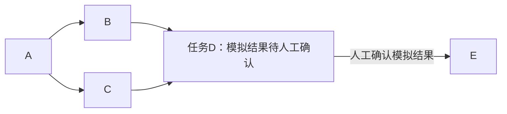

# 开发任务模拟编排演示

此功能把已确认计划变成独立的模拟任务运行。规划流程继续负责需求、规格、架构/任务、检查和确认导出；模拟运行负责观察任务依赖和交互。模拟完成不是编码完成、测试通过或软件交付。

## 准备固定验收任务图

在Node.js 22.21+环境执行：

```powershell
npm run simulation:demo
$env:DATA_DIR = 'output/simulation-demo-data'
$env:PORT = '4320'
npm start
```

数据写入单独的`output/simulation-demo-data`，不调用模型，不修改默认data。命令由用户自行启动演示，不需要重启或覆盖已有4317服务。首次使用先安装锁定依赖`npm ci --ignore-scripts`。若本机默认Node版本过旧，应先切换到符合要求的版本。

打开 http://127.0.0.1:4320，选择“模拟编排 A-B/C-D-E”。这是明确标注的确定性任务夹具，未调用真实PM模型；脚本只确认固定示例规格，计划停在待确认。请在页面核对任务后点击“确认计划并导出”。现有模型生成的工程计划确认后也可使用同一模拟入口，本轮验证使用模拟模型资料及确定性夹具。



## 页面操作

1. 打开“开发任务”。模拟面板保持并发2，时长可设1500毫秒，以便观察。示例任务D已标记人工确认，无需重复填写。
2. 点击“启动模拟编排”。A模拟完成后B/C同时运行；只有两者都完成后D才启动。D结果产生后停在“待人工确认”，E没有执行尝试。
3. 点击D查看目标、输入输出、验收和规格来源，以及依赖、等待原因、尝试和状态历史。在面板填写确认依据，再点详情中的“确认此模拟结果”。E才会启动，最后状态为“模拟完成”。
4. 导出模拟记录，检查kind、realAcceptance:false、版本和历史。模拟记录不提供真实代码、测试通过结论或已验收源码下载。
5. 再启动一个新模拟运行，首次失败任务ID填B。C继续完成，D/E阻塞。点击B→“重试此模拟任务”，A/C不重跑，B原失败记录仍在；B成功后D再次按人工门禁等待。
6. 在A或B/C进行中点击“阶段边界暂停”：在途任务允许结束，后续不启动。继续后重新检查依赖。等待确认也可以暂停；暂停期间确认结果不会派发E，需先继续。
7. 刷新页面，选择历史模拟运行查看保存的状态、失败和确认依据。服务停止/重启后活动模拟显式中断，不自动完成；继续不会把失败任务改成成功，失败任务需单独重试。

## 普通项目与版本

只有当前需求、规格、计划版本一致且双确认和规划导出完成后才可启动。文件范围不明确、非法依赖或并行共享写入会明确阻止启动。普通规则计划中的目录、通配符或`.gitignore`等建议不是允许的精确写入文件；请在计划确认前人工修订为允许路径（src/public/migrations/tests/docs下允许的精确文本文件，或根README.md）。不能仅降低并发绕过共享写冲突，应先在计划里建立明确串行依赖并重新确认。

每项目仅一个活动模拟运行，活动期间禁止修改规划及应用需求变更。旧计划记录保留历史；通过已有规格/计划修订和重新确认流程产生新计划后，启动的是全新模拟状态，旧完成不继承。中断或失败运行可在版本仍有效时继续/重试，版本已变化时只读。

首版是单机JSON保存和650毫秒轮询，没有真实编码、多Worker、可靠自动恢复或团队身份认证。确认依据为自由文本，不代表有身份验证的审批签名。完整契约见[API](API.md#开发任务模拟编排)。

## 验证方式

`npm run simulation:test`运行相关自动化和实际Edge页面检查，使用临时数据，不调用模型。完整历史测试中的真实MXC/编码/付费模型不在本轮范围。当前验证结果见[任务记录](tasks/simulated-task-orchestration.md)。
